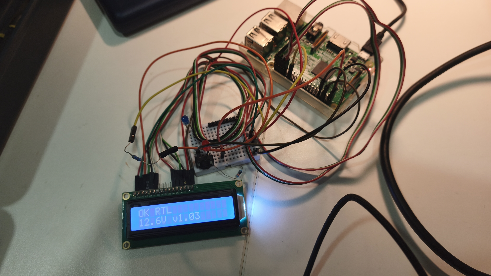

# piobc: Raspberry Pi onboard computer (prototype)

A small learning prototype of an onboard computer for an autonomous boat. A Raspberry Pi talks MAVLink to a simulated ArduPilot boat (SITL on my laptop), shows the link status on an LCD, and runs as systemd services. I also experimented with failsafe tests and a simple release process.

## What it does

- **Monitor:** listens to the autopilot heartbeat and shows OK / DEGRADED / LOST, mode, battery and version on a 16x2 LCD.
- **systemd:** the monitor and the LCD run as two services that restart if they crash and start at boot.
- **Failsafes:** the Pi sends its own heartbeat; if it stops, the autopilot switches to HOLD. Low battery switches to RTL.
- **Tests:** three pytest tests against SITL: parameters match `config/boat.param`, low battery → RTL, monitor stopped → HOLD.
- **Releases:** each version is a git tag. A timer on the Pi installs new tags into their own folder and switches a `current` symlink; rolling back means pointing it at the old one.

